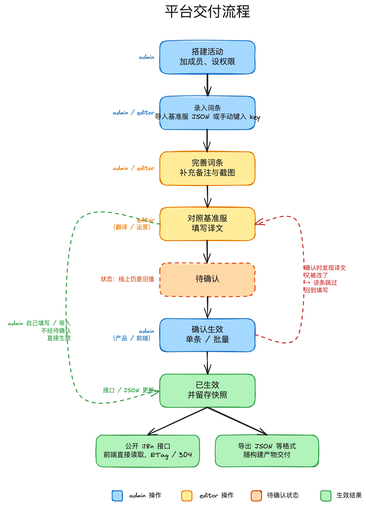
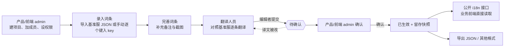
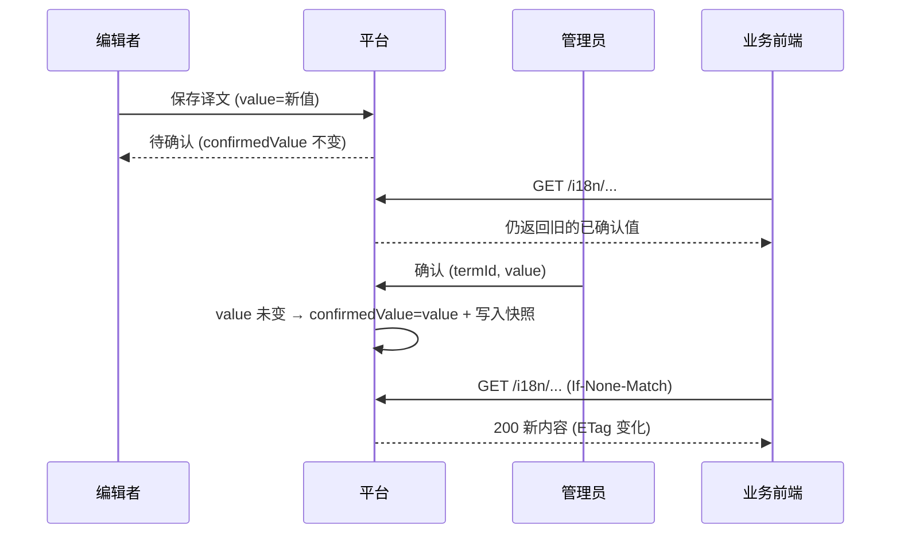

# 多语言翻译平台：设计交互背景

> 本平台基于开源项目 [ever-co/ever-traduora](https://github.com/ever-co/ever-traduora) 二次开发，面向内部「基准服文案 → 多语种交付」流程：每个项目先有一个基准服（通常是国服，也可能是其他服）的文案，其他语种对照它翻译。
> 本文说明：为什么要改、角色怎么分工、各模块做什么、一条文案从录入到上线的完整交互，以及目前需要注意的边界。

---

## 1. 背景与目标

### 1.1 要解决的问题

多语言交付以前靠飞书文档 / JSON 文件在产品、前端、运营之间来回传，常见问题：

- **翻译进度不透明**：哪些 key 还没翻、哪些语种做完了，飞书文档里只能靠人去看、去问。现在有按语言的待确认角标和"待翻译"筛选，进度一眼可见。
- **前端接入麻烦**：每次要把飞书里的译文手动复制粘贴到本地 JSON，再随前端发布，容易漏、错行、格式出错，每个语种每次都要重复做。现在可以直接读接口，或一键导出 JSON。


## 2 交付流程


### 3.1 创建成员
由这个活动对应的产品或者是开发，为对应的运营开通账号和权限
<video src="创建成员.mov" controls width="720"></video>


### 3.2 创建活动
接着由产品或者开发创建对应的活动
<video src="创建活动.mov" controls width="720"></video>


### 3.2 创建词条key & 创建服
可以由开发直接从开发仓库导入对应的基准的某个服的json，或者由产品逐个手动填入词条key
<video src="创建词条服.mov" controls width="720"></video>


### 3.3 填写译文
把链接给到对应服的各个运营，可以逐步填写翻译了

ps：说明为啥需要待确认的环节（通常有产品或者是开发进行确认，因为这个不分服，防止改动后里面影响接口api的返回，导致线上服务出问题，所以设定一个关卡需要确认）


### 3.4 获得多语言i18n
通过直接导出各个服的json打包到代码编译时，或者通过接口api返回


平台里每个**项目**（一个活动对应一个项目，业务侧用活动 id 与之关联）有独立的成员列表，成员在项目内有一个角色。

### 3.1 三种角色

| 角色 | 页面显示 | 典型人员 | 能做什么 |
| --- | --- | --- | --- |
| `admin` | 管理员 | 产品、前端开发 | 一切操作：管理成员与权限、增删词条、填写/导入译文（**直接生效**）、**确认待确认译文**、管理 API 客户端、删除语言/项目 |
| `editor` | 编辑者 | 翻译、运营 | 增删改词条、填写/导入译文（**进入待确认**）、导出、查看团队与 API 客户端 |
| `viewer` | 只读 | 观察者 | 只能查看和导出，看不到「导入」入口 |

> 权限在后端逐动作校验（见 [actions.ts](api/src/domain/actions.ts)）。`ConfirmTranslation` 刻意**不**放进 editor / viewer 的允许列表，所以只有 admin 能确认。

### 3.2 账号与登录

- **管理员**：邮箱 + 密码登录。默认管理员由环境变量（`TR_ADMIN_PASSWORD` 等）在启动时自动创建。
- **其他成员**：admin 在「团队」里按邮箱添加，系统自动建一个**无密码账号**；成员之后**只输入邮箱**即可登录，前提是该邮箱已被加入某个项目。
- **API 客户端**：用 `client_id` + `client_secret` 换 token（`client_credentials`），供脚本 / CI 使用，也带有角色。
- 登录接口有限流，防止暴力尝试。

> 本平台**仅在公司内网使用，不对公网开放**，因此成员"仅凭邮箱登录"是有意的取舍：省掉密码和邮件流程，访问边界由内网保证。

---

## 4. 核心概念

| 概念 | 说明 |
| --- | --- |
| **项目 Project** | 一个独立的文案集合，有自己的成员、词条、语言。 |
| **词条 Term** | 一个 key，例如 `login.title`。通常对应基准服文案的一个 key。 |
| **语言 Locale** | 项目下启用的语种（简体、繁体、英文、日文等）。其中一个是**基准服**（通常是国服，也可能是其他服），它的 JSON 先导入，作为其他语种翻译的**参照**；平台本身不限定哪个服是基准，它只是项目里的一个普通语言。 |
| **译文 Translation** | 某词条在某语言下的内容，有两个值（见下）。 |
| **备注 / 上下文 Context** | 词条上的说明：文字 + 截图，帮助翻译理解语境。 |
| **版本快照 TranslationVersion** | 每次确认后保存的该语言完整已生效 JSON。 |

### 4.1 译文的两个值（最关键的设计）

每条译文同时保存：

- `value`：**最新填写值**（运营刚改的，可能还没被确认）。
- `confirmedValue`：**已确认值**（线上真正使用的）。`null` 表示从未确认过。

状态由二者的关系决定：

```
value == confirmedValue   →  已确认（已生效）
value != confirmedValue   →  待确认
value 为空                →  未翻译
```

> 判断规则：`value <> COALESCE(confirmedValue, '')` 即为待确认。

---

## 5. 总体流程



分工一句话：**admin 负责搭建和确认，editor 负责填内容，确认后才对线上生效。**

---

## 5. 模块介绍

左侧菜单（见 [ProjectContainer.tsx](webapp/src/components/projects/ProjectContainer.tsx)）依次是：

### 5.1 项目列表
- 展示当前账号参与的所有项目及自己的角色。
- 创建项目的人自动成为该项目 admin。
- 每个用户可创建的项目数受 `maxProjectsPerUser` 限制。

### 5.2 词条
- 管理 key 列表：新增、修改 key、删除、搜索（按 key 或备注）。
- **备注编辑器**：写文字，也可以粘贴截图说明"这句话出现在哪个界面"。图片限制：png / jpeg / gif / webp，单张 ≤ 2MB；按文件头校验真实类型，**不允许 SVG**（防 XSS）。
- 备注图片在备注里只留 `[[img:<uuid>]]` 标记，后端字符串上限 1000 字符，旧数据无需迁移。

### 5.3 导入
- 支持上传 JSON 等多种格式文件，一次性导入词条和某个语言的译文。
- 典型用法：把**基准服 JSON**（国服或其他服）导入，批量生成词条；也可以导入某语种的已有译文。
- **导入行为取决于角色**：admin 导入 → 直接生效并留快照；editor 导入 → 进入待确认。viewer 看不到入口。
- 受项目套餐字符串数量上限（语言数 × 词条数）约束。

### 5.4 对照翻译（矩阵视图，默认首页）
- 一张表同时展示：词条 key、备注、基准服文案及多个目标语言，便于对照翻译。
- 每个单元格失焦自动保存。
- 筛选：`全部` / `待翻译` / `待确认`。
- 待确认的单元格下方显示"线上当前值"，admin 可以直接在格子里确认。
- 简体 / 繁体的 language 都是 Chinese，因此用 `Chinese（China）` 这种带地区的名字区分。

### 5.5 按语言翻译
- 先看到语言列表，每个语言上有**待确认数量**的角标。
- 进入某个语言后逐条编辑；admin 可**批量确认**该语言下的待确认译文。
- 适合一个翻译专门负责一门语言的场景。

### 5.6 团队
- admin 按邮箱添加成员并设置角色（admin / editor / viewer）。
- 邮箱是新的，则自动创建无密码账号。
- 限制：不能修改或移除**自己**，避免最后一个 admin 把自己锁在外面。

### 5.7 API 客户端
- 为脚本 / CI 创建 `client_id` + `client_secret`，并设定角色。
- 用于自动化导入、拉取，不依赖人的账号。

### 5.8 导出
- 选择语言与格式导出文件。格式包括 jsonflat、jsonnested、csv、xliff、yaml、properties、po、strings、php、resx、androidxml 等。
- 可选"只导出未翻译"和"回退语言"（缺失的 key 用回退语言补全）。

### 5.9 设置
- 项目名称、描述、删除项目等。

### 5.10 公开 i18n 接口（给业务前端）

```
GET /api/v1/i18n/:projectId/:localeCode
```

- **无需登录**；`projectId` 是平台生成的 uuid，业务前端把它和**活动 id** 做对应后传入（一个活动对应一个项目）。
- **只返回已确认值**：运营刚提交、尚未确认的内容不会出现。
- 返回扁平 JSON：`{ "login.title": "Sign in", ... }`，空值不返回，缺失的 key 由前端**回退到基准服文案**。
- 带 `ETag`；前端传 `If-None-Match` 命中时返回 `304`。响应头为 `Cache-Control: no-cache`（每次都校验，但可以走 304）。

---

## 6. 关键交互流程

### 6.1 搭建项目（admin）

1. 登录 → 创建项目（自己成为 admin）。
2. 「团队」添加翻译 / 运营邮箱，设为 `editor`；负责确认生效的产品或前端设为 `admin`。
3. （可选）「API 客户端」为脚本创建凭据。

### 6.2 录入词条（admin 或 editor）

- **方式 A：导入基准服 JSON** → 批量生成词条，基准服语言作为参照。
- **方式 B：手动键入** → 在「词条」页逐个新增 key。
- 在「词条」页补备注 / 截图。
- 在项目里启用目标语言：新增语言时，系统会为已有的每个词条建一条空译文。

### 6.3 翻译（editor）

1. 打开「对照翻译」或「按语言翻译」。
2. 对照基准服文案与备注填写译文，失焦自动保存。
3. 保存后该条变为**待确认**（`value ≠ confirmedValue`）；语言列表上的待确认角标 +1。

> admin 自己填写 / 导入的内容**直接生效**，不再走待确认，并会留存快照。

### 6.4 确认（admin）

1. 在「待确认」筛选下查看变更。
2. 单条确认或整批确认。
3. 后端在**同一事务**中完成：把 `confirmedValue` 置为 `value`、写入一份完整快照。一次批量确认只产生一份快照。

**并发保护**：确认请求会带上 admin 当时看到的 `value`。如果在 admin 看到之后翻译又改了，该条会被**跳过**（返回 `skipped` 计数），避免"确认了一个自己没看过的值"。



### 6.5 交付

两条路径，按场景选：

| 路径 | 适用 | 内容 |
| --- | --- | --- |
| 公开 i18n 接口 | 业务前端运行时直接读取，改完确认即生效 | **仅已确认值** |
| 导出文件 | 打包进构建产物、离线交付 | 见下方注意事项 |

---

## 7. 数据与接口速览

### 7.1 数据表（新增 / 改动）

| 表 | 说明 |
| --- | --- |
| `translation` | 新增 `confirmedValue`（可空） |
| `translation_version` | 新增：`projectLocale` + 递增 `version` + 完整 `content` + `changedKeys` + `confirmedById`（API 客户端确认时为 null） |
| `term_image` | 新增：词条备注图片，按项目归属，级联删除 |

对应迁移：`1794100000000-translation-confirmation`、`1794200000000-term-image`。

### 7.2 主要接口

| 接口 | 权限 | 作用 |
| --- | --- | --- |
| `POST /api/v1/auth/token` | 公开（限流） | 管理员密码登录 / 客户端凭据换 token |
| `POST /api/v1/auth/email-login` | 公开（限流） | 成员仅凭邮箱登录；管理员账号会被要求用密码 |
| `GET/POST/PATCH/DELETE /api/v1/projects/:id/users` | admin 可写 | 成员管理 |
| `PATCH /api/v1/projects/:id/translations/:locale` | editor+ | 保存译文（admin 直接生效，editor 待确认） |
| `POST /api/v1/projects/:id/translations/:locale/confirm` | **仅 admin** | 批量确认，返回 `{confirmed, skipped, version}` |
| `GET /api/v1/projects/:id/translations` | 成员 | 语言列表，附 `pendingCount` |
| `POST /api/v1/projects/:id/imports` | editor+ | 导入 |
| `GET /api/v1/projects/:id/exports` | 成员 | 导出 |
| `POST /api/v1/projects/:id/term-images` | 成员 | 上传备注图片 |
| `GET /api/v1/i18n/:projectId/:locale` | **公开** | 已生效 i18n JSON |

---

## 8. 注意事项与已知边界

> 以下是对照当前代码得出的结论，接入前请确认。

1. **「导出」目前导出的是 `value`（最新填写值），不是 `confirmedValue`。**
   见 [exports.controller.ts](api/src/controllers/exports.controller.ts)：导出文件会包含**未确认**的内容；而公开 i18n 接口只返回已确认值。
   → 需要"导出只含已生效内容"的话，导出逻辑需改为读 `confirmedValue`（或增加参数）。在改之前，**对外交付请优先使用公开 i18n 接口**，或确保导出前已处理完待确认。
2. **版本快照只有写入，暂无回滚 / 查看入口**：目前只存数据，用于出问题时对照旧值；每语言保留最近 50 份，更早的在写入新快照时顺带清理。
3. **成员仅凭邮箱登录**：见 2.2，依赖"仅内网使用"这一前提；若以后改为对外开放，需要重新评估登录方式。
4. **公开 i18n 接口无需登录**：知道项目 id 即可读取。仅内网使用时风险可控，但未发布的活动文案仍建议只在内网访问。
5. **无邮件**：加成员、重置密码等都不会发通知，需线下告知成员。
6. **admin 修改自己的角色 / 删除自己被禁止**：保证项目始终有 admin。

---

## 9. 后续可演进方向

- 导出支持"仅已生效内容"开关。
- 快照查看、对比与一键回滚。
- 待确认内容的差异展示（旧值 vs 新值）与驳回理由。
- 变更通知（飞书 / 站内），替代已移除的邮件。
- 按项目维度的审计日志（谁在什么时候改了什么）。
