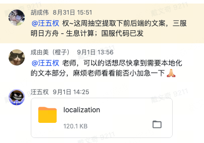
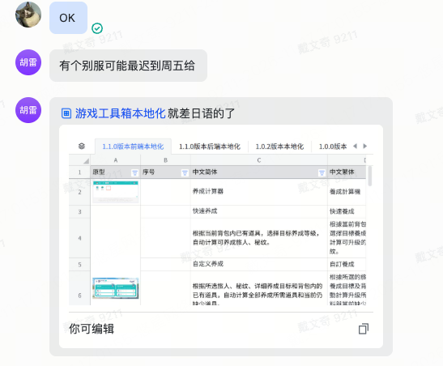
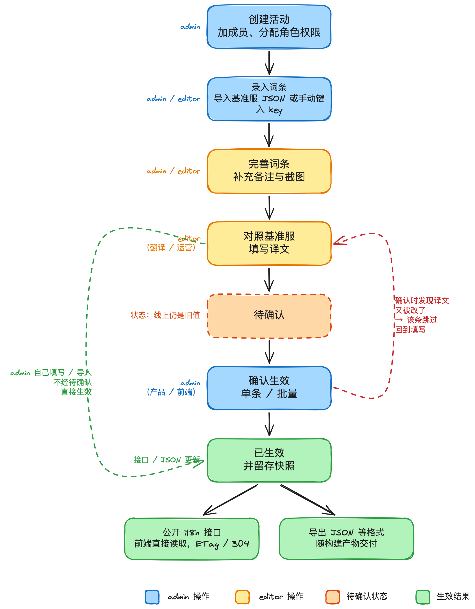

# 多语言翻译平台：设计交互背景

> 本平台基于开源项目 [ever-co/ever-traduora](https://github.com/ever-co/ever-traduora) 二次开发，面向内部「基准服文案 → 多语种交付」的流程：每个活动先有一个基准服（通常是国服，也可能是其他服）的文案，其他服对照它翻译。
>
> 本文说明：为什么要做这个平台、角色如何分工、从文案录入到上线的完整交互。

---

## 1. 背景与目标

### 1.1 C端业务两种多语言协作方式

**情形 1：第三方提供的代码仓库**

从第三方提供的代码仓库中提取文案，交给相关运营，后续运营按照约定的格式提供译文。



**情形 2：我们自己的代码库**

多语言文案来自飞书文档，运营直接在飞书文档上填写译文。



### 1.2 存在的问题

多语言交付以前依靠飞书文档和 JSON 文件，在产品、前端、运营之间来回传递，常见问题有：

- **翻译进度不透明**：哪些 key 还没翻、哪些服已经做完，只能靠人去看、去问。
- **前端接入麻烦**：每次都要把飞书里的译文手动复制到本地 JSON。

因此需要一个专门的平台，把文案、各服译文、填写进度和确认状态集中管理：运营在线填写、进度实时可见，经开发或产品确认后才生效，前端再通过接口或导出直接取用，不再手工搬运。

---

## 2. 交付流程



整体顺序为：**建活动 → 加成员 → 建服和词条 → 运营填译文 → 开发确认 → 导出或通过接口取用**。

**相比开源项目的变化**：鉴于是二次开发，围绕目前的交付模式做了增减，各步骤的变化如下：

| 步骤 | 简化 | 新增 |
| --- | --- | --- |
| 2.1 创建活动 | 不需要注册，由管理员直接登录创建 | — |
| 2.2 创建成员 | 不发邀请邮件，管理员直接填写邮箱添加；成员只用邮箱登录，无需密码 | — |
| 2.3 创建词条与服 | 语言由数百种精简为五个服；导入导出只保留 JSON 和 CSV | 词条备注可粘贴截图；导入时保持 JSON 的数组结构和 key 顺序 |
| 2.4 填写译文 | — | 「对照翻译」视图；**「待确认」二次确认**：运营的改动由开发或产品确认后才生效 |

另外，注册、找回密码、邮箱验证、第三方登录、邮件发送、邀请、标签等用不到的功能都已删除。

### 2.1 创建活动

由产品或开发（管理员账号）创建对应的活动。

<video src="创建活动.mp4" controls width="720"><a href="创建活动.mp4">▶ 观看视频：创建活动</a></video>

- **活动是什么**：一个活动包含一套词条和若干个服的译文。活动之间相互独立，成员、API 凭证和导出都按活动隔离，互不影响。
- **活动 ID**：显示在浏览器地址栏中，形如 `/activities/<uuid>/...`，之后通过接口获取译文时会用到。
- 创建者会自动成为该活动的管理员。

### 2.2 创建成员

由这个活动对应的产品或开发，为对应的运营开通账号和权限。

<video src="创建成员.mp4" controls width="720"><a href="创建成员.mp4">▶ 观看视频：创建成员</a></video>

- **运营如何登录**：只需要邮箱，**不需要密码**，因此邮箱务必填写准确。
- **权限范围**：成员只能看到被加入的活动，看不到其他活动。
- 只有管理员可以添加、移除成员和修改角色。

### 2.3 创建词条 key 与服

可以由开发直接从开发仓库导入某个基准服的 JSON，也可以由产品逐个手动填写词条 key。

<video src="创建词条服.mp4" controls width="720"><a href="创建词条服.mp4">▶ 观看视频：创建词条与服</a></video>

**创建服**

- 点击左侧「按服翻译」，再点击「添加服」。目前可选的就是业务用到的五个服：国服（`zh_CN`）、港澳台（`zh_TW`）、美服（`en_US`）、韩服（`ko_KR`）、日服（`ja_JP`）。
- 基准服（如国服）的文案就是其他服的「原文」。在「对照翻译」页顶部可以切换「原文语言」。

**创建词条 key（两种方式）**

1. **开发导入**（推荐，适合一次性导入一批）
   - 点击左侧「导入」，上传 JSON，目标语言选择基准服，文件格式选择「JSON 嵌套」。
   - 嵌套对象会拼接成 `a.b.c` 形式的 key；**数组会拆成 `list.0`、`list.1` ……**，导出时再还原成数组，并且**保持与原始文件一致的 key 顺序**。
   - 管理员导入的内容**直接生效**；对同一个 key 重复导入会覆盖更新，不会重复创建。
2. **产品手动新增**
   - 点击左侧「词条」，再点击「新增词条」，填写 key 和备注。
   - **备注很重要**：运营要靠它判断这句话出现在哪里、是什么场景。备注支持文字，也可以**直接粘贴截图**。
   - 新增的词条会排在列表末尾。

**词条管理**
- 删除词条会同时删除它在所有服的译文，**且无法恢复**。修改 key 会影响前端代码中对它的引用，修改前请先与前端确认。
- 新增词条后，每个已添加的服里都会自动出现一条「待填写」的空译文。

### 2.4 填写译文

把活动链接发给各个服对应的运营，运营就可以逐步填写译文了。

**运营填写译文：**

<video src="编辑者.mp4" controls width="720"><a href="编辑者.mp4">▶ 观看视频：运营填写译文</a></video>

**开发 / 产品确认：**

<video src="确认者.mp4" controls width="720"><a href="确认者.mp4">▶ 观看视频：开发 / 产品确认</a></video>

> **为什么需要「待确认」环节？**
> 词条和接口返回的内容是各个服共用的，不分服。如果运营的改动直接生效，一旦改错，可能影响接口返回，进而导致线上服务出问题。因此增加一道关卡：由产品或开发确认后，译文才会生效。

**运营如何填写**

- 把活动链接发给运营，运营用邮箱登录后即可进入该活动。
- 有两个视图，可按习惯选择：
  - **对照翻译**：左边是基准服原文，右边每个服一列，对着原文逐行填写。适合同时处理多个服；支持搜索原文、译文和 key，也可以只看「有未填写」或「有待确认」的行。
  - **按服翻译**：只看某一个服，顶部有进度条（已填写 / 未填写），适合一位运营负责一个服。
- **保存**：输入框失焦（点击其他位置）或按回车即自动保存，`Shift + Enter` 为换行，没有单独的保存按钮。
- **状态标签**：灰色的「待填写」表示还没有内容；橙色的「待确认」表示已填写但尚未生效，下方会显示「线上当前」的值，方便对比改了什么。

**确认规则**

- 编辑者（运营）的改动**不会立即对外生效**，而是进入「待确认」状态。只有管理员可以确认，确认后才会出现在接口返回的内容中。
- 管理员自己导入或修改的内容无需再确认，直接生效。

### 2.5 获取多语言 i18n

可以导出各个服的 JSON，在代码编译时打包进去；也可以通过接口按需获取。

**手动导出 JSON：**

<video src="导出json.mp4" controls width="720"><a href="导出json.mp4">▶ 观看视频：手动导出 JSON</a></video>

**通过 API 接口导出：**

<video src="导出api.mp4" controls width="720"><a href="导出api.mp4">▶ 观看视频：通过接口导出</a></video>

#### 方式一：手动导出（适合随前端打包）

- 选择 JSON 嵌套格式导出时，会还原成原始文件的结构：数组仍是数组，key 顺序也保持一致。
- 手动导出的是**当前最新的译文，包含「待确认」的内容**。

#### 方式二：接口读取

两种接口都能获取译文，但内容和用途不同：**公开读取接口返回的是线上已生效的版本**，**带凭证导出返回的是最新编辑的版本（导出成文件）**。

| | 公开读取接口 | 带凭证导出 |
| --- | --- | --- |
| 是否需要登录 | 不需要，知道活动 ID 即可 | 需要，先用 API 凭证换取令牌 |
| 返回内容 | 只返回**已确认**的译文 | 返回**最新**译文，**包含待确认**的内容 |
| 格式 | 固定为平铺 JSON，如 `{"a.0": "…"}` | 可选格式；`jsonnested` 能还原嵌套结构、数组和 key 顺序，也可导出 CSV |
| 缺少译文时 | 默认不返回该 key，由前端回退到国服文案；加 `?includeEmpty=true` 则返回全部 key，缺的值为空字符串 |
| 典型用途 | 业务前端线上运行时动态拉取 | 脚本、构建时生成 JSON 文件打进代码包 |

**1. 公开读取接口（给业务前端使用）**

```http
GET {域名}/api/v1/i18n/{活动ID}/{服}

# 示例
GET https://xxx/api/v1/i18n/1590554a-.../zh_CN

# 返回全部 key（没确认的值为空字符串）
GET https://xxx/api/v1/i18n/1590554a-.../ja_JP?includeEmpty=true
```

- 返回平铺格式，例如 `{"guideDialogues.0": "…", "guideDialogues.1": "…"}`。
- **默认**：某个 key 没有已确认的译文时**不会返回**，前端需要回退到国服文案。
- **`?includeEmpty=true`**：返回该活动的**全部 key**，已确认的给出译文，没填或还没确认的值是空字符串，例如 `{"guideDialogues.0": "ffffff", "guideDialogues.2": ""}`，key 的顺序与导入的原始文件一致。适合想看清哪些 key 还没翻的场景。

**2. 带凭证导出（可拿到完整文件）**

- 点击左侧「API 凭证」，再点击「生成凭证」，得到客户端 ID 和密钥。**密钥只显示一次**，丢失后可以点击「重置密钥」生成新的，旧密钥立即失效。每个活动只有一个凭证。
- 先换取令牌，再携带令牌导出：

  ```http
  POST {域名}/api/v1/auth/token
  Content-Type: application/json

  {"grant_type": "client_credentials", "client_id": "…", "client_secret": "…"}
  ```

  返回结果中的 `access_token` 即为令牌。

  ```http
  GET {域名}/api/v1/activities/{活动ID}/exports?locale=zh_CN&format=jsonnested
  Authorization: Bearer <access_token>
  ```

- 与手动导出一样，这种方式**包含待确认的内容**。
- 凭证只能访问自己所属的活动。密钥请放在环境变量或公司的密钥管理系统中，不要写进代码仓库。

---

## 3. 技术架构

### 3.1 当前架构

| 层 | 技术 | 说明 |
| --- | --- | --- |
| 前端 | React 18、TypeScript、Vite、Ant Design 5 | 使用 zustand 管理状态、React Router 做路由、axios 请求接口 |
| 后端 | NestJS 11（Node.js）、TypeORM | 提供 `/api/v1` 下的 REST 接口，用 JWT 做登录和接口鉴权 |
| 数据库 | MySQL | 通过迁移脚本自动建表和升级；项目本身也兼容 PostgreSQL |
| 包管理 | pnpm | 前端 `webapp` 和后端 `api` 各自独立安装依赖 |
| 部署 | Docker | 前端构建产物由后端统一托管，一个镜像即可运行 |

整体调用关系：

```
浏览器（React）──HTTP /api/v1──▶ 后端（NestJS）──▶ MySQL
业务前端 / 脚本 ──公开读取接口或带凭证的接口──▶ 后端（NestJS）
```

### 3.2 后续规划

**1. 后端由 NestJS 迁移到 Go（Gin）**

后续计划把后端从 NestJS 换成 **Go + Gin** 框架实现，前端和数据库保持不变。迁移时遵循以下原则：

- **接口协议基本不变**：保持 `/api/v1` 下的路径、请求参数和返回结构一致（登录相关接口见下一条），这样前端、业务前端和已有脚本都不需要改动。
- **数据库不变**：继续使用现有的 MySQL 表结构和数据，迁移时只替换访问数据库的代码。

**2. 接入公司 IDaaS 登录**

目前成员靠「管理员添加公司邮箱」登录后续计划接入公司的 **IDaaS（统一身份认证）**，让登录更方便
